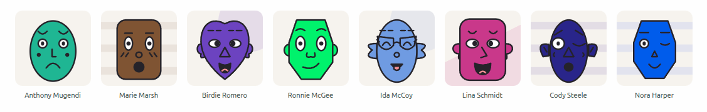

# Facitars

Small, colorful, gender-neutral SVG faces from any non-empty string. The same seed produces the same avatar and primary color in Node.js and browsers, without a DOM, network requests, SVG.js, or JSDOM.



**Facitars** was built after I tried dozens of others and couldn't find one that provided support for all of the following:

1. Creating lightweight (no complex curves and paths) SVG avatars. 

2. Generating and Returning a unique (seed generated) color for each avatar. This is useful for applications where you wish to color code certain parts of your UI based on a users ID/email or whatever your seed value may be.

3. Most importantly, this project is generates SVG avatars both in the browser and on the server in a consistent manner. 

4. Finally, all avatars generated should be of the same size so as to fit well in grids and UIs

## Install

```sh
npm install facitars
```

Node.js 18 or newer is required for this release's supported Node environment. Consumers do not need Yarn, Webpack, or an install-time build.

## Node.js

```js
const Facitars = require('facitars').node();
const facitars = new Facitars();

const { svg, color } = await facitars.generate('Anthony Mugendi', 160);
// svg: a standalone SVG string
// color: '#2eb992', useful for matching interface accents
```

Use this inside an async function in CommonJS. You can write `svg` to a file, return it with an `image/svg+xml` content type, or use it as an image source.

## Browser

Copy the distributed bundle to your site's assets:

```html
<script src="./facitars.min.js"></script>

<script>
  (async () => {
    const { svg } = await new Facitars().generate('Anthony Mugendi');
    document.getElementById('avatar').src =
      'data:image/svg+xml;charset=utf-8,' + encodeURIComponent(svg);
  })();
</script>
```

The bundle is published as `dist/facitars.min.js`. It contains its rendering dependencies and does not load scripts from a CDN. For a browser application using a bundler:

```js
const Facitars = require('facitars').browser();
const { svg, color } = await new Facitars().generate('your-user-id');
```

Browser bundlers resolve to the prebuilt renderer, avoiding Node-specific dependency imports. `.browser()` and `.node()` return the same class, including when imported through a bundler.

## Geometry and variation

The eight categories provide **400 designs** in total. Each category has **10 shape families × 5 geometry variants = 50 designs**. Colors and absence do not count toward that total.

| Feature | Example families | Optional |
| --- | --- | --- |
| `face` | Round, heart, diamond, tapered | No |
| `eyes` | Almond, sleepy, happy, wink | No |
| `nose` | Button, triangle, bridge, upturned | No |
| `mouth` | Smile, grin, smirk, tongue | No |
| `eyebrows` | Arch, angled, worried, asymmetric | No |
| `ears` | Lobed, pointed, cupped, folded | Yes |
| `glasses` | Round, cat eye, half rim, sunglasses | Yes |
| `cheeks` | Patches, freckles, dimples, diamonds | Yes |

Avatars have no hairstyles, beards, moustaches, or stubble. Cheek details use geometric ink marks rather than pink blush or heart decorations. Names are seeds only; the generator never infers gender from them.

The variants change dimensions, curves, spacing, or angles using small SVG primitives. There are no image assets or fonts inside an avatar. Optional details are sometimes omitted by the seed selection to keep faces readable.

Every feature gets an independent selection derived from the seed and category name. Adding a new category does not consume randomness from the others. The renderer has no mutable per-avatar state, so concurrent calls on one instance are safe. Different seeds are not guaranteed to produce different avatars or colors.

## API

### `await facitars.generate(seed, size = 80, features = {})`

Returns `{ svg, color }`.

- **`seed`**: a string, or a value whose `.toString()` returns a non-empty string. `0` and `false` work; empty strings, `null`, and `undefined` are rejected. Strings are case-sensitive; spaces and Unicode are preserved.
- **`size`**: a finite, positive number for both SVG dimensions. All avatars use `viewBox="0 0 80 80"`, so resizing preserves their geometry.
- **`features`**: optional overrides. Each feature accepts an integer **0–49**; optional features also accept `null` to hide them. Unknown names and invalid values are rejected. Unspecified features remain seed-selected.

```js
const { svg, color } = await facitars.generate('hello', 160, {
  eyes: 42,      // wink, third geometry
  glasses: 12,  // square frames, third geometry
  ears: null,   // omit this optional feature
});
```

Indices are zero-based: `Math.floor(index / 5)` selects the family, and `index % 5` selects its geometry. `Facitars.features` is a read-only catalog containing each category's `count`, `optional` flag, and ordered `families` names.

The returned SVG never contains the seed text. Give rendered images an accessible name in your application, as in the browser example above.

## Playground and visual review

From this repository:

```sh
npm ci
npm run build
npm run playground
```

Open **http://127.0.0.1:3000**. The playground provides:

- Live string input, size selection, primary color, and actual SVG byte size.
- A large preview and previews at 24, 40, and 64 pixels.
- Comparison avatars, SVG source, and SVG download.
- All 50 variants of each feature on a fixed reference face. Select one to apply it to your avatar; reset to return to seed selection.

Everything runs locally. The development server serves only the playground files and bundle on loopback. It uses port 3000; stop it with Ctrl+C. Alternatively, serve the repository root with your own static server and open `/examples/index.html`.

To render a file from Node:

```sh
node examples/node.js "Your string"
```

This updates `examples/test.svg`.

## Migrating from 1.x

This is a **major release**: avatars for existing seeds change. Keep stored SVGs or continue using 1.x if you need the old appearance.

- Keep your existing `.node()`, `.browser()`, `new Facitars()`, and `await generate(seed, size)` calls. The `{ svg, color }` result is unchanged.
- Primary colors preserve the 1.x algorithm and seed preprocessing for previously valid seeds.
- Remove any SVG.js script included solely for Facitars. No `window.SVG`, JSDOM injection, or asynchronous script loading is needed.
- Drawing internals such as `draw`, `window`, and individual drawing methods are no longer provided. Use `generate()` and the feature overrides.
- Invalid sizes, including `NaN`, infinity, zero, and negative values, are now rejected.
- This repository uses `package-lock.json` and npm instead of the old Yarn lockfile.

## Development

```sh
npm test          # Determinism, validation, colors, all variants, browser-bundle parity
npm run build     # Rebuild the checked-in production bundle
npm run build:dev # Watch source changes; writes dist/facitars.js
```

The playground uses the production bundle: run `npm run build` after source changes to refresh it. Build before running tests that check source/bundle parity. `npm pack` rebuilds the distribution before packaging; installation does not run a build.
